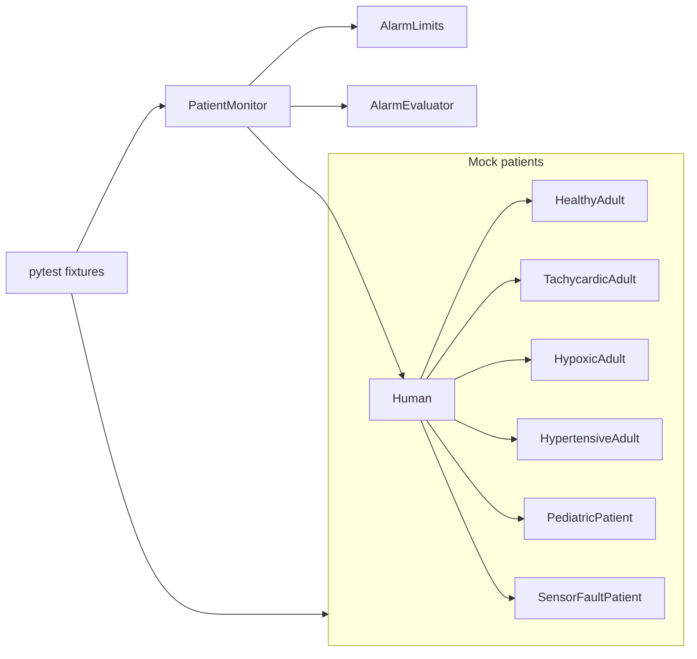

# Mock Patient Monitor Tester

The user confirmed software safety class **C** on 2026-10-20. This mock follows the IEC 62304:2006+AMD1:2015 Class C activity set (planning, requirements, architecture, detailed design, unit verification, integration, and system test). It is not a claim of conformity, certification, or an FDA/MDR submission. No hazard IDs are invented; the two approved risk controls are software requirements `SSS006` and `SSS007`.

Folder choice, from the user: `.sdoc` sources in [`requirements/`](requirements/), generated HTML in [`docs/`](docs/). StrictDoc 0.30.1 writes HTML to `<output>/html`, so export uses `--output-dir docs` and the site is `docs/html/`. Pytest writes [`docs/pytest-report.html`](docs/pytest-report.html). This departs from the `reqs/html` and `requirements_html/` rules because the user specified `docs/`.

The repo is otherwise empty (README, license, gitignore). Origin is `git@github.com:dapperfu/medical_device_testing.git` on `main`. There is no `upstream` remote. Already-staged submodule files (`.gitmodules`, `.cursor/rules`) stay out of these commits. The StrictDoc MCP server here can export and validate; it does not provide `create_requirement`, so requirements are written as `.sdoc` files.

## Mock limits and patients

Limits are mock test values, not clinical guidance. A value equal to a limit does not alarm. Alarms use `>` or `<`.

Adult profile (age 18 or older): heart rate outside 50–120 bpm; SpO2 `< 90%`; systolic `> 160` mmHg or diastolic `> 100` mmHg; temperature outside 35.0–38.0 °C.

Pediatric profile (age under 18): heart rate outside 70–160 bpm; SpO2 `< 92%`; systolic `> 120` or diastolic `> 80`; temperature outside 35.5–38.0 °C.

Fixture values, each a subclass of `Human`:

- `HealthyAdult`: age 35, HR 72, SpO2 98, BP 118/76, temp 36.8 °C, sensor valid. No alarm.
- `TachycardicAdult`: age 45, HR 140, SpO2 97, BP 124/78, temp 36.9 °C. `HEART_RATE` only.
- `HypoxicAdult`: age 60, HR 88, SpO2 85, BP 122/80, temp 36.7 °C. `SPO2` only.
- `HypertensiveAdult`: age 55, HR 78, SpO2 97, BP 180/95, temp 36.8 °C. `BLOOD_PRESSURE` from systolic only.
- `PediatricPatient`: age 8, HR 140, SpO2 98, BP 110/70, temp 36.8 °C. No alarm. HR 140 would alarm on the adult profile, which is how the test shows profile selection.
- `SensorFaultPatient`: age 40, sensor invalid, vitals `None`. `SENSOR_FAULT` only. No vital-sign alarm.

`set_limits` accepts only: HR low 20–200, HR high 30–250 and strictly above HR low, SpO2 low 50–100, systolic high 80–250, diastolic high 40–150, temperature low and high inside 30.0–43.0 with high strictly above low. Anything else raises `LimitRejected` and leaves the previous limits in place.

## Approved requirements

Parent links run SRS → SSS → SDD/IRS, and SSS → TP/TD → pytest. IDs below are the ones this work will create.

System ([`requirements/srs/SRS.sdoc`](requirements/srs/SRS.sdoc)):

- `SRS001`: When monitoring is running and the sensor is valid, the monitor shall present the attached patient's heart rate (bpm), SpO2 (%), systolic and diastolic pressure (mmHg), and temperature (°C).
- `SRS002`: The monitor shall raise an alarm when a valid vital sign is outside the limit profile for that patient's age.
- `SRS003`: The monitor shall raise a sensor-fault alarm when the measurement is invalid, and shall not raise a vital-sign alarm from an invalid measurement.
- `SRS004`: The monitor shall reject an alarm-limit command outside the allowed range and shall leave the limits already in effect unchanged.
- `SRS005`: The test harness shall run the software system tests and publish an HTML results report.

Software ([`requirements/sss/SSS.sdoc`](requirements/sss/SSS.sdoc)):

- `SSS001` (parent `SRS001`): While running with a valid sensor, the monitor shall report that patient's five vital values unchanged.
- `SSS002` (parent `SRS002`): Age 18 or older selects the adult profile; age under 18 selects the pediatric profile. Numeric limits are the ones listed above.
- `SSS003` (parent `SRS002`): A vital sign equal to its limit shall not raise that alarm.
- `SSS004` (parent `SRS001`): Before `start` and after `stop`, the monitor shall report no alarms and shall not present vitals as valid. `start` with no patient shall be rejected.
- `SSS005` (parent `SRS001`): `attach` shall store the patient and select that patient's default profile.
- `SSS006` (parent `SRS003`, risk control): Invalid sensor shall raise only `SENSOR_FAULT`, with vitals not valid.
- `SSS007` (parent `SRS004`, risk control): `set_limits` shall reject an out-of-range command and shall not use the rejected limits for alarm evaluation.
- `SSS008` (parent `SRS005`): The harness shall provide function-scoped fixtures `healthy_adult`, `tachycardic_adult`, `hypoxic_adult`, `hypertensive_adult`, `pediatric_patient`, `sensor_fault_patient`, and `patient_monitor`, each returning a new instance per test.
- `SSS009` (parent `SRS005`): `make test` shall write a self-contained pytest HTML report to `docs/pytest-report.html`, including software version `0.1.0`, Python and package versions, the date, and the OS user as the person who ran the test.

Design, interface, plan, and tests:

- [`requirements/sdp/SDP.sdoc`](requirements/sdp/SDP.sdoc): class C confirmation, life cycle for this increment, PEP 8 enforced by Ruff, verification by pytest unit then integration then system test, SOUP list, and traceability. No fixed-size buffers, so memory-overflow acceptance criteria are recorded as not applicable to this design.
- [`requirements/sdd/SDD.sdoc`](requirements/sdd/SDD.sdoc): units `Human`, `AlarmLimits`, `AlarmEvaluator`, `PatientMonitor`, and the pytest harness. No segregation is claimed; every item stays at Class C.
- [`requirements/irs/IRS.sdoc`](requirements/irs/IRS.sdoc): `attach`, `start`, `stop`, `set_limits`, `vitals`, `alarms`.
- [`requirements/tp/TP.sdoc`](requirements/tp/TP.sdoc): unit tests before integration tests; system tests cover every `SSS` item; results are the HTML report.
- [`requirements/td/TD.sdoc`](requirements/td/TD.sdoc): one test description per test function, parent-linked to the `SSS` item it verifies.

SOUP, named with version in the SDP and pinned in `pyproject.toml` / `uv.lock`: pytest and pytest-html (pytest-dev), Ruff (Astral), StrictDoc 0.30.1. The monitor package has no runtime dependency. Published-anomaly review is recorded as not done; this tree is a mock and is not released medical-device software.

## Software shape



Package `medical_device_testing` under `src/`, Python 3.12, `uv sync` into `.venv`.

- [`src/medical_device_testing/humans/human.py`](src/medical_device_testing/humans/human.py) and one module per subclass
- [`src/medical_device_testing/device/alarm_limits.py`](src/medical_device_testing/device/alarm_limits.py), [`alarm_evaluator.py`](src/medical_device_testing/device/alarm_evaluator.py), [`patient_monitor.py`](src/medical_device_testing/device/patient_monitor.py)
- [`src/medical_device_testing/__main__.py`](src/medical_device_testing/__main__.py) for `make run`: attach the healthy adult, start, print vitals and alarms

Code comments use `# Implements: SSS00N`. Tests use `# Verifies: SSS00N`.

## Pytest layout

```
tests/
  conftest.py          # pytest_plugins and HTML metadata
  fixtures/            # one fixture module per human, plus patient_monitor
  unit/                # AlarmLimits, AlarmEvaluator, Human population
  integration/         # monitor plus each patient fixture
  system/              # every SSS item, including both risk controls
```

[`pyproject.toml`](pyproject.toml) sets `addopts` to `--html=docs/pytest-report.html --self-contained-html`. A `pytest_configure` hook adds version, tool, and operator metadata.

[`Makefile`](Makefile) targets: `build` (`uv sync`), `test`, `run`, `lint` (Ruff), `clean`, `help`, and `strictdoc-validate`, `strictdoc-generate`, `strictdoc-export`, `strictdoc-serve`, `strictdoc-tree`, `strictdoc-help`. Config is [`strictdoc_config.py`](strictdoc_config.py) (`create_config()` returning `ProjectConfig`), because StrictDoc 0.30 deprecates TOML config. [`docs/index.html`](docs/index.html) links `html/index.html` and `pytest-report.html`.

## Git during execution

Commits follow `.cursor/rules/git/`: local `user.name` / `user.email`, one file per commit, requirement file together with the code or test that completes it, TODO checkoff in the same commit as the work that finishes that TODO. Commit messages include the `Requirements:` section (`Specifies`, `Implements`, or `Verifies`). After each commit, push to `origin` because that remote exists. Fetch `origin` before committing. Do not fetch a missing `upstream`. Do not stage the existing submodule changes.
